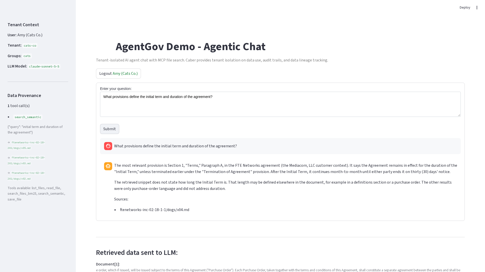
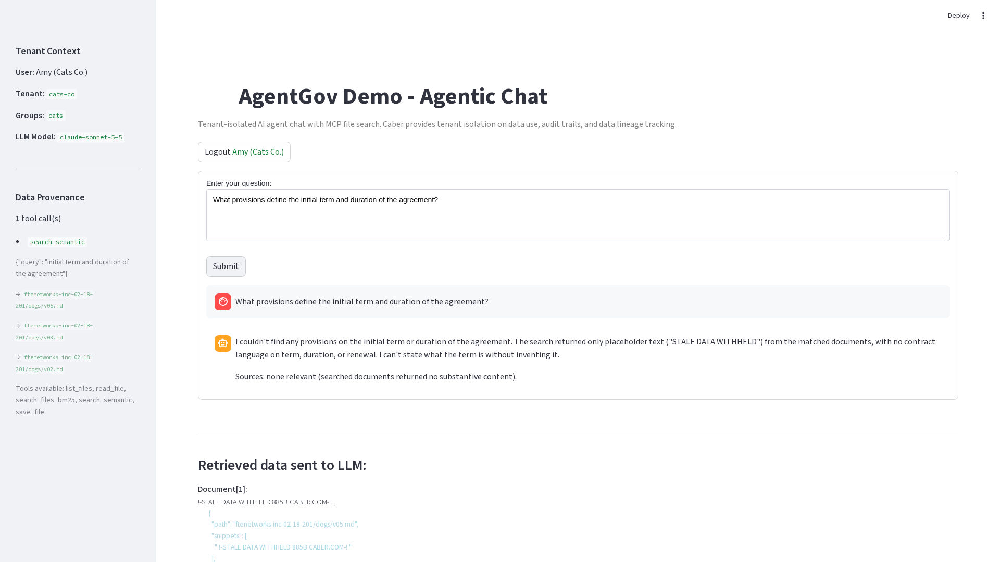

# Caber Community Preview: the agentic-tools demo

<!-- profile:begin -->
<p align="center">
  <a href="https://caber.com">
    <picture>
      <source media="(prefers-color-scheme: dark)" srcset="https://raw.githubusercontent.com/Caber-Systems/.github/main/images/caber-logo-dark-mode.svg">
      
    </picture>
  </a>
</p>

<h1 align="center">Active Data Use Control for Agentic AI</h1>
<p align="center"><i>Freshness, provenance, and policy, checked down to the sentence before agents see it.</i></p>

<p align="center">
  <strong><a href="https://github.com/Caber-Systems/examples">Try the free preview</a></strong> ·
  <a href="https://docs.caber.com">Read the docs</a> ·
  <a href="https://caber.com">Caber website</a>
</p>

***
<!-- profile:end -->

In **`demos/agentic-tools/`**, a LangGraph agent chooses among four MCP tools and writes its own vector-store queries over a corpus of contracts. Caber intercepts and governs every tool result down to the sentence, so what the agent sees depends on **who asked**, **how fresh the content is**, and **whether it is a duplicate copy**. Once images are pulled, building and starting the stack to healthy takes about **45 seconds**.

**Before you start.** Runs on **macOS** or **Linux** (`x86_64` or `arm64`; Windows is not supported). You need:

- **Docker Desktop** (macOS/Linux) or **Docker Engine** (Linux) with Compose 2.20+, at least **16 GB RAM** allocated to Docker, and **20 GB** free disk
- **Python 3.10+** (standard library only—nothing to install) and **`git`**
- An **OpenAI API key** (or an API key for another supported LLM provider—Anthropic, NVIDIA, Gemini, or Groq; the demo has baked-in model defaults and skips any provider without a key; see the [Configuration & Environment Variables docs](https://docs.caber.com/configuration/environment-variables.html))

This demo has full functionality. [Click here](#license) for limitations and license information.

## Quick Start: Six Commands

Run these in a single terminal window:

### 1. Clone this repository

```bash
git clone https://github.com/Caber-Systems/examples
cd examples
```

**What you will see.** Git clones `examples/` on your machine and returns to the prompt.

### 2. Add your OpenAI API key and check your machine

```bash
export OPENAI_API_KEY="<your OpenAI API key>"
./demo.py check
```

**What you will see.** `check` verifies your OS, Docker memory, disk space, local ports (`3000`, `8050`, `8082`, `8083`), and tests your key against the baked-in default models (`gpt-6-luna` and `text-embedding-3-small`), then prints `check passed.` (Nothing is written on your machine besides `examples/runner/__pycache__/`.)

> **Tip:** Prefer Anthropic, NVIDIA, Gemini, or Groq? Set that provider's `<PROVIDER>_API_KEY` instead—any provider without an API key is skipped automatically. To persist your key across terminal sessions, add it to `.env.local`. See [Other LLM providers](#other-llm-providers) below.

### 3. Build the demo

```bash
./demo.py build
```

**What you will see.** Prints the Community Preview license notice, pulls the pinned platform images from `preview.lock.json`, and builds the two local demo app images (`caber-preview/agentic-chat-app:local` and `caber-preview/mcp-server:local`) on your machine inside Docker.

### 4. Run the demo

```bash
./demo.py run
```

**What you will see.** Generates `examples/.env.local` on your machine, starts the containers in observe mode, seeds the contract corpus (`policies: nothing to activate for this demo.`), opens the browser tabs, and prints:

```
console: http://localhost:3000
dashboard: http://localhost:8050
chat: http://localhost:8083
What to try:
  - Which service categories appear in my contracts and what security controls do they require?
  - Break down the monthly pricing and payment terms listed across my contract documents.
  - Describe the automatic renewal clauses and termination conditions in my agreements.
  - Summarize the scope of services and compliance obligations found in my available contracts.
  - What are the billing structures and total monthly costs for contracts I have access to?
```

**Tips for exploring Observe Mode:**

- **Run in observe mode first:** answers flow through unchanged while the Caber Console records every policy hit, stale version, and duplicate snippet.
- **Flip to enforce mode with one command:** Caber redacts unauthorized, stale, and duplicate text before the agent ever sees it.

1. Open the chat app at http://localhost:8083 and sign in as **`amy@demo.local`** (password: **`cats123`**), or try **`bob@demo.local`** (**`dogs123`**) to compare what a different user is entitled to see.
2. Ask one of the suggested questions above.
3. Open the Caber Console at http://localhost:3000 to inspect the live audit trace. In observe mode, the answer goes through unchanged while the Console flags what Caber would have redacted:
   - **F2U deny**: content from a contract owned by another user's group ([Provenance & Principal Attribution](https://docs.caber.com/functionality/provenance-and-principal-attribution.html)).
   - **Stale**: text from a superseded contract version ([Freshness & Stale Clustering](https://docs.caber.com/functionality/freshness-and-stale-clustering.html)).
   - **Duplicate**: redundant text from a duplicate copy ([Metapolicies & Multisource Governance](https://docs.caber.com/functionality/metapolicies-and-governance.html)).



### 5. Switch to enforce mode

```bash
./demo.py enforce
```

**What you will see.** Restarts the chat app and MCP server on your machine with redaction enabled, reopens the chat tab, and prints:

```
Mode: enforce (CSI_GLOBAL_REDACT_ENABLED=true).
```

Sign in again as **`amy@demo.local`** (`cats123`) and ask the **exact same question**. Caber now withholds unauthorized, stale, and duplicate contract text before the LLM sees it, and the Console records the enforced redaction:



### 6. Stop and clean up

```bash
./demo.py down
```

**What you will see.** Prints the LLM token usage for your session, stops and removes the containers, network, volumes, and demo images on your machine, and prints `Help: https://github.com/Caber-Systems/examples/discussions`. See the [command summary](#demopy-command-summary) below for options to switch modes or keep images between runs.

## Everything the demo puts on your machine

Nothing is written outside `examples/`, Docker, your system temp directory, and your browser:

| What | Where | Removed by |
| --- | --- | --- |
| Repository & `runner/__pycache__/` | `examples/`, `__pycache__/` | deleting `examples/` |
| Local secrets (`0600`) | `examples/.env.local` | `./demo.py down --purge` or deleting `examples/` |
| Pulled & built demo images, containers (`agentic-tools_default`), and volumes (`agentic-tools_*`) | Docker | `./demo.py down` |
| Base image & build cache | `python:3.12-slim`, Build cache | `docker image rm python:3.12-slim`, `docker builder prune` |
| Temporary token-usage copy & browser tabs | `caber-demo-usage-*`, browser tabs | `./demo.py down` (auto-deleted), closing tabs |

## demo.py command summary

Run `./demo.py --help` or see the [Demo CLI Reference](https://docs.caber.com/demos-and-benchmarks/demo-cli-reference.html) for full details.

### Other LLM providers

Model defaults are baked into `.env.template`. Every command reads settings from the shell first, then `.env.local`. An existing `.env` beside `.env.template` is read too.

- **OpenAI (simplest):** Set `OPENAI_API_KEY`. Default models (`gpt-6-luna` and `text-embedding-3-small`) are used automatically.
- **NVIDIA or Gemini:** Set `NVIDIA_API_KEY` or `GEMINI_API_KEY` (each provides both chat and embeddings out of the box).
- **Anthropic or Groq:** Set `ANTHROPIC_API_KEY` or `GROQ_API_KEY` for chat, plus `SELECTED_EMBEDDING_PROVIDER` (`OPENAI`, `NVIDIA`, or `GEMINI`) and that provider's API key for embeddings.

### Documentation Links

- [Caber Documentation Home](https://docs.caber.com)
- [Demos & Benchmarks Guide](https://docs.caber.com/demos-and-benchmarks/)
- [Caber User Console & Audit Forensics](https://docs.caber.com/console/)
- [pycaber(auto) SDK Guide](https://docs.caber.com/sdks/pycaber-auto-sdk.html)
- [Environment Variables & Configuration](https://docs.caber.com/configuration/environment-variables.html)
- [Community Preview Limits & Resetting](https://docs.caber.com/legal/community-preview-limits.html)

## Numbers from the last green run

<!-- lock:begin -->
Measured on 2026-11-18

Recorded in `preview.lock.json` by the last green CI run.

pycaber 0.2.5683 from https://pypi.org/simple

| Image | Digest |
| --- | --- |
| `ghcr.io/caber-systems/caber-core:0.2.5683` | `sha256:b359ae31426f` |
| `ghcr.io/versity/versitygw:v1.7.0` | `sha256:c4cbd9d9cb8d` |
| `opensearchproject/opensearch:2.19.5` | `sha256:4ee82ecb35d8` |
| `softwaremill/elasticmq-native:1.6.11` | `sha256:fe3af4a8dd59` |
| `ghcr.io/caber-systems/caber-console` | `sha256:32d73e1ae3e7` |
| `ghcr.io/caber-systems/mock-idp:preview` | `sha256:000000000000` |

Durations of that run, in seconds:

- build: 2 s
- run_to_healthy: 45 s
- ci_total: 9 s

LLM tokens that run used, per provider:

| Provider | Chat model | Embedding model | Chat input | Chat output | Embedding tokens | Requests |
| --- | --- | --- | --- | --- | --- | --- |
| anthropic | claude-sonnet-5-5 | nvidia/nemotron-3-embed-1b | 142328 | 10156 | 106752 | 673 |
| gemini | gemini-3.8-flash | nvidia/nemotron-3-embed-1b | 118739 | 4837 | 106670 | 667 |
| groq | openai/gpt-oss-120b | nvidia/nemotron-3-embed-1b | 97785 | 10406 | 106729 | 671 |
| nvidia | meta/muse-glimmer-30b | nvidia/nemotron-3-embed-1b | 108532 | 15051 | 106788 | 676 |
| openai | gpt-6-luna | nvidia/nemotron-3-embed-1b | 81956 | 3660 | 106840 | 672 |
<!-- lock:end -->

## Help

Ask questions and share what you built in [GitHub Discussions](https://github.com/Caber-Systems/examples/discussions) (Q&A and Show-and-tell). For licensing questions, email support@caber.com.

## License

<!-- notice:begin -->
Caber's code in this repository is MIT licensed (LICENSE), the pycaber SDK from PyPI and the caber-core and caber-console (CaberUserConsole) container images are licensed under the [Caber Community Preview Edition License v1.2](https://raw.githubusercontent.com/Caber-Systems/preview-license/v1.2/LICENSE-PREVIEW.md) (shipped here as LICENSE-PREVIEW.md; see [Community Preview Limits](https://docs.caber.com/legal/community-preview-limits.html) for evaluation limitations), and every other image and package the demo pulls or installs is licensed by its owner.
<!-- notice:end -->
